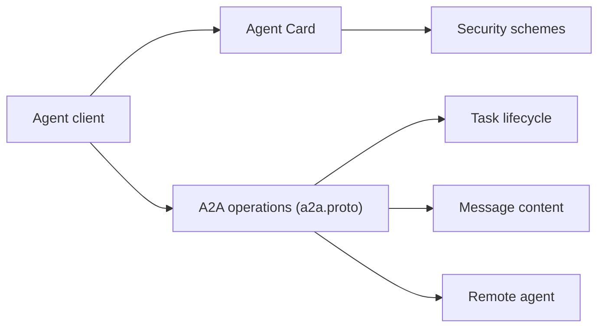

# a2aproject/A2A

> Protocole ouvert pour que des agents IA de frameworks différents se découvrent et collaborent.

## Le problème
Des agents construits sur des frameworks et chez des éditeurs différents ne partagent aucun langage commun pour coopérer.

## Ce que ça fait vraiment
Spécifie JSON-RPC 2.0 sur HTTP(S), la découverte via « Agent Cards », les échanges synchrones, en streaming (SSE) ou en notifications push, et le transfert de texte, fichiers et JSON structuré. Les agents restent opaques (pas de partage d'état interne). Ce dépôt porte la spécification ; des SDK existent en Python, Go, JS, Java, .NET et Rust.

## Comment c'est branché


## Essayer
```bash
pip install a2a-sdk
go get github.com/a2aproject/a2a-go
npm install @a2a-js/sdk
```

## Coût et pièges
Gratuit. Les agents derrière peuvent, eux, coûter des clés d'API. Le README liste des évolutions à venir (autorisation dans l'AgentCard, etc.) : spécification encore en mouvement.

## Ce que ce n'est pas
Pas un serveur ni un framework d'agents : un protocole. Il complète MCP (agents entre eux), sans le remplacer.

## Alternatives
- MCP : outils pour un agent, d'après le cours cité (A2A complète MCP).

## Pour toi
À suivre si tu orchestres plusieurs agents hétérogènes ; sous la Linux Foundation, donc relativement neutre.

