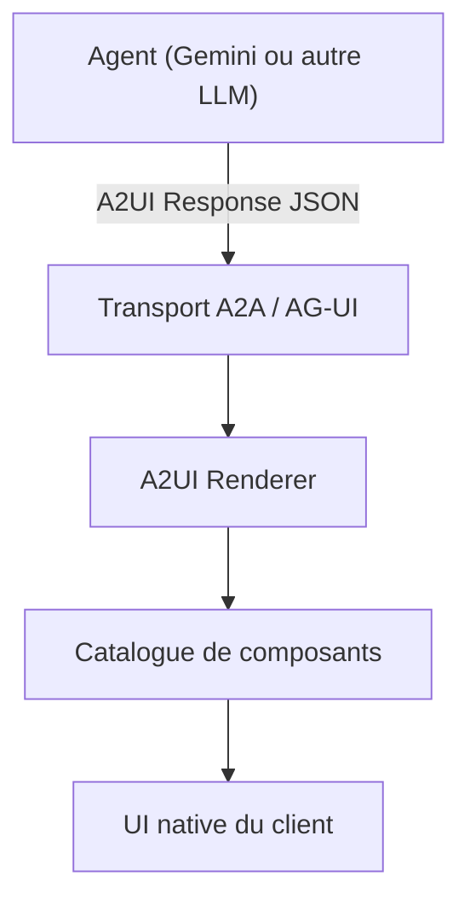

# a2ui-project/a2ui

> Declarative JSON format and renderers so that agents generate safe interfaces.

## The problem
A remote agent cannot send executable code to a client application, but must be able to present a rich interface.

## What it actually does
README identical to that of google/A2UI (same stars and dates in the catalog: same project, different organization name). The agent sends JSON describing the UI, the client renders it with its catalog of trusted components. No diagram provided for this repository.

## How it is wired
No diagram provided; schema deduced from the README's Architecture section.


## Trying it
```bash
git clone https://github.com/a2ui-project/a2ui.git
cd a2ui
export GEMINI_API_KEY="your_gemini_api_key"
corepack enable
yarn install
cd samples/client/lit
yarn demo:restaurant
```

## Cost and gotchas
Gemini API key, Node.js 18+ and uv for the demo. Several packages are marked "Not published yet".

## What it is not
Not an agent framework. Not needed for a React chat alone, says the README.

## Alternatives
- AG-UI: compatible transport.
- genui: Flutter package replaced by a2ui_flutter.

## For you
Watch, like google/A2UI of which this is the duplicate: worth following for remote agents with generated interfaces.
