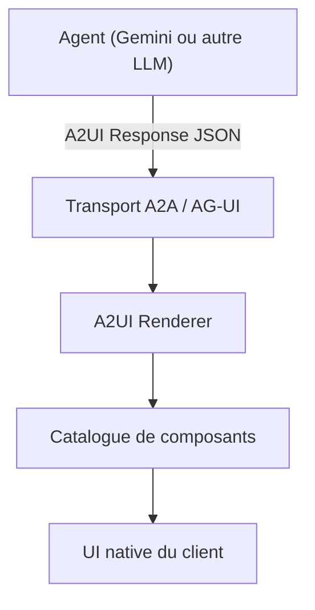

# a2ui-project/a2ui

> Format déclaratif JSON et moteurs de rendu pour que des agents génèrent des interfaces sûres.

## Le problème
Un agent distant ne peut pas envoyer de code exécutable à une application cliente, mais doit pouvoir présenter une interface riche.

## Ce que ça fait vraiment
README identique à celui de google/A2UI (mêmes étoiles et dates dans le catalogue : même projet, nom d'organisation différent). L'agent envoie du JSON décrivant l'UI, le client la rend avec son catalogue de composants de confiance. Aucun diagramme fourni pour ce dépôt.

## Comment c'est branché
Aucun diagramme fourni ; schéma déduit de la section Architecture du README.


## Essayer
```bash
git clone https://github.com/a2ui-project/a2ui.git
cd a2ui
export GEMINI_API_KEY="your_gemini_api_key"
corepack enable
yarn install
cd samples/client/lit
yarn demo:restaurant
```

## Coût et pièges
Clé d'API Gemini, Node.js 18+ et uv pour la démo. Plusieurs paquets sont marqués « Not published yet ».

## Ce que ce n'est pas
Pas un framework d'agents. Pas nécessaire pour un chat React seul, dit le README.

## Alternatives
- AG-UI : transport compatible.
- genui : paquet Flutter remplacé par a2ui_flutter.

## Pour toi
Surveiller, comme google/A2UI dont c'est le doublon : à suivre pour des agents distants à interface générée.

