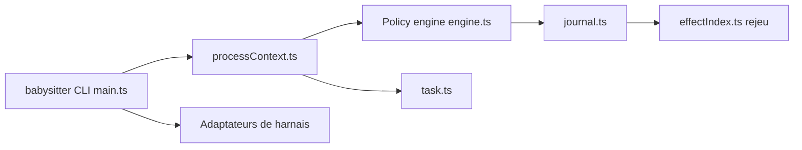

# a5c-ai/babysitter

> An orchestrator that constrains coding agents to follow a process written in JavaScript, with human stop points.

## The problem
An agent decides on its own when it is done, with no guardrails or trace; long workflows drift and do not resume after an interruption.

## What it actually does
The process is JavaScript code: tasks, human approval breakpoints, quality gates, parallelism. A mandatory stop after each step lets the process decide what comes next. All decisions go into an event journal for replay and resume. Twelve supported harnesses (Claude Code, Codex, Cursor, Gemini CLI, Copilot…), an internal harness with no external agent, token compression (hooks) and a process library. The repository also contains a Kanban backlog and the Kradle inference platform.

## How it is wired


## Trying it
```bash
npm install -g @a5c-ai/babysitter
claude plugin marketplace add a5c-ai/babysitter-claude
claude plugin install --scope user babysitter@a5c.ai
claude "/babysitter:call implement user authentication with TDD"
```

## Cost and gotchas
Node 20+ (22.13+ for the `adapters` CLI), an installed harness; tokens at your expense. Most harnesses other than Claude Code are "experimental" or in beta. 427 open issues. Several packages to tell apart.

## What it is not
The "no hallucination" claim is not demonstrated: the process constrains the flow, not the generated content. The token reductions (50 to 67%) are the author's figures. The README is very broad (Kradle, atlas, kip-sdk).

## Alternatives
No alternative named in the README.

## For you
Worth watching: the process-as-code approach with a replayable journal deserves study for agent orchestration, but the scope is broad and unstable.
