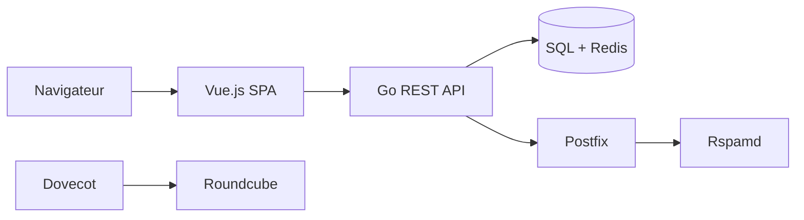

# aaPanel/BillionMail

> Self-hosted mail server and emailing platform, for companies that send campaigns.

## The problem
Emailing platforms are expensive or closed, and a mail server is hard to set up by hand.

## What it actually does
A set of containers: Go backend, Vue interface, Postfix (SMTP), Dovecot (IMAP/POP3), Rspamd (antispam), Roundcube as webmail, SQL database and Redis. It manages domains, DNS, SSL, campaigns, templates, contacts and statistics. The README claims an eight-minute install and unlimited sending: unverified claims.

## How it is wired


## Trying it
```bash
cd /opt && git clone https://github.com/aaPanel/BillionMail && cd BillionMail && bash install.sh
bm help
bm show-record
```

## Cost and gotchas
You need a server with a proper IP, DNS and sending reputation; deliverability remains your responsibility. AGPL-3.0 license. The README text calls it a "future" tool.

## What it is not
It is not a service that manages sending reputation. "Unlimited" says nothing about what providers will accept.

## Alternatives
No alternative named in the README (Roundcube is an integrated component there).

## For you
Worth watching: interesting for sovereign mail, but with no direct link to data/AI and heavy to operate.
