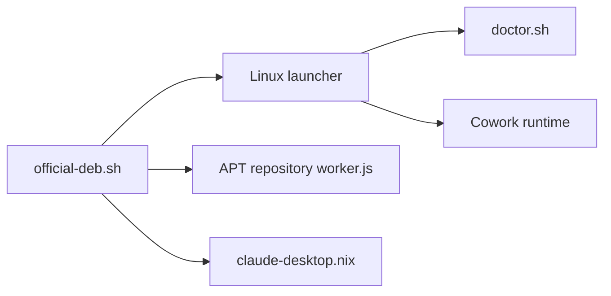

# aaddrick/claude-desktop-debian

> Unofficial repackaging of Claude Desktop for Linux: .rpm, AppImage, Nix, with launcher and diagnostics.

## The problem
Anthropic only publishes a .deb for Linux; other distributions and sessions are poorly served.

## What it actually does
Since v3.0.0, it repackages the official .deb as .rpm, AppImage and a Nix flake, named `claude-desktop-unofficial`. It adds a launcher (optional Wayland, GPU crash recovery), a `--doctor` and five Linux fixes. A triage bot sends the content of issues to the Anthropic API.

## How it is wired


## Trying it
```bash
sudo apt update
sudo apt install claude-desktop-unofficial
sudo dnf install claude-desktop-unofficial
nix profile install github:aaddrick/claude-desktop-debian
```
(after adding the APT/DNF repositories described in the README)

## Cost and gotchas
Free, but the app requires a Claude account. Do not run official and unofficial together: they share `~/.config/Claude`. Handover to @sabiut in September 2026.

## What it is not
Not an Anthropic product: no official support.

## Alternatives
- aur/claude-desktop: community package of the official .deb on Arch, without launcher.

## For you
Worth watching: useful if you are on Fedora, Nix or AppImage; on Debian/Ubuntu, the official .deb is enough.
