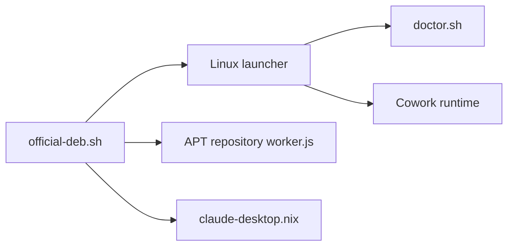

# aaddrick/claude-desktop-debian

> Repaquetage non officiel de Claude Desktop pour Linux : .rpm, AppImage, Nix, avec lanceur et diagnostic.

## Le problème
Anthropic ne publie pour Linux qu'un .deb ; les autres distributions et sessions sont mal servies.

## Ce que ça fait vraiment
Depuis la v3.0.0, repaquette le .deb officiel en .rpm, AppImage et flake Nix, nommés `claude-desktop-unofficial`. Ajoute un lanceur (Wayland optionnel, récupération de crash GPU), un `--doctor` et cinq correctifs Linux. Un bot de triage envoie le contenu des issues à l'API Anthropic.

## Comment c'est branché


## Essayer
```bash
sudo apt update
sudo apt install claude-desktop-unofficial
sudo dnf install claude-desktop-unofficial
nix profile install github:aaddrick/claude-desktop-debian
```
(après ajout des dépôts APT/DNF décrits dans le README)

## Coût et pièges
Gratuit, mais l'app exige un compte Claude. Ne pas faire tourner officiel et non officiel ensemble : ils partagent `~/.config/Claude`. Passage de relais à @sabiut en septembre 2026.

## Ce que ce n'est pas
Pas un produit Anthropic : aucun support officiel.

## Alternatives
- aur/claude-desktop : paquet communautaire du .deb officiel sur Arch, sans lanceur.

## Pour toi
À surveiller : utile si tu es sous Fedora, Nix ou AppImage ; sous Debian/Ubuntu, le .deb officiel suffit.

