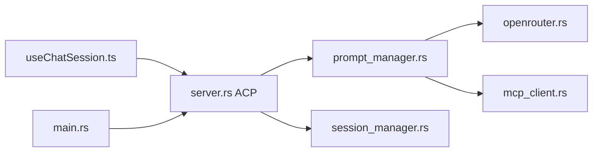

# aaif-goose/goose

> Agent IA, open-source, local (desktop app, command-line interface, API), written in Rust, for general code and workflow purposes.

## The problem
You need an agent that interacts with your machine, using the model provider of your choice, without relying on a single SaaS platform.

## What it actually does
A session (desktop, CLI, or API) loads or creates a session state, constructs the prompt, calls a model provider, and then invokes MCP extensions before responding. Permissions, configuration, session storage, recipe validation, and gateway channels are handled separately. More than 15 providers and over 70 extensions are available.

## How it is wired


## Trying it
```bash
curl -fsSL https://github.com/aaif-goose/goose/releases/download/stable/download_cli.sh | bash
```

## Cost and gotchas
Free. LLM tokens are charged by the chosen provider, or covered by an existing subscription via ACP. Some UI-to-server connections are not verified within the architecture.

## What it is not
Not a template or hosted service: it's the harness. "Not just for code" is a README positioning, which is not measured.

## Alternatives
No alternative is specified in the README.

## For you
Recommended for testing: MCP multi-vendor agent in Rust, supported by a foundation, allowing for local use with Ollama for your data workflows.
