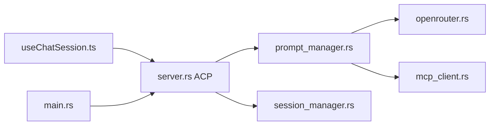

# aaif-goose/goose

> Agent IA open source local (app desktop, CLI, API) en Rust, pour le code et les workflows généraux.

## Le problème
Il faut un agent qui agisse sur ta machine, avec le fournisseur de modèle de ton choix, sans dépendre d'un SaaS unique.

## Ce que ça fait vraiment
Une session (desktop, CLI ou API) charge ou crée un état de session, construit le prompt, appelle un fournisseur de modèle, puis invoque des extensions MCP avant de répondre. Permissions, configuration, stockage des sessions, validation de recettes et canaux de passerelle existent à part. Plus de 15 fournisseurs, 70+ extensions.

## Comment c'est branché


## Essayer
```bash
curl -fsSL https://github.com/aaif-goose/goose/releases/download/stable/download_cli.sh | bash
```

## Coût et pièges
Gratuit. Les tokens LLM sont facturés par le fournisseur choisi, ou couverts par un abonnement existant via ACP. Certains liens UI-vers-serveur ne sont pas vérifiés dans l'architecture.

## Ce que ce n'est pas
Pas un modèle ni un service hébergé : c'est le harnais. « Pas que pour le code » est un positionnement du README, non mesuré.

## Alternatives
Aucune alternative nommée dans le README.

## Pour toi
À adopter pour essayer : agent MCP multi-fournisseurs en Rust, soutenu par une fondation, donc exploitable en local avec Ollama pour tes workflows data.

