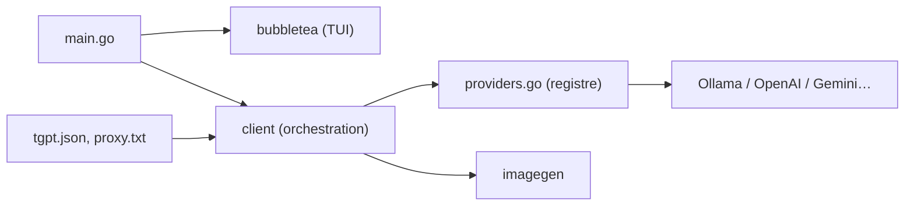

# aandrew-me/tgpt

> Command-line client to chat with AI providers from the terminal, in Go.

## The problem
Querying a model without leaving the shell or opening a browser.

## What it actually does
Cross-platform Go binary. The README kept only installation, updating and proxy; the provider list ("Currently available providers") is empty in the supplied text. The architecture, based on the code, shows a provider registry (DeepSeek, DuckDuckGo, Gemini, Groq, Kimi, Ollama, OpenAI, Phind, Pollinations…), a bubbletea TUI layer and an image generation module. API keys and per-provider cost are not documented in this README.

## How it is wired


## Trying it
```bash
curl -sSL https://raw.githubusercontent.com/aandrew-me/tgpt/main/install | bash -s /usr/local/bin
brew install tgpt
go install github.com/aandrew-me/tgpt/v2@latest
tgpt -u
```

## Cost and gotchas
Free on the tool side. The installation script is run via `curl | bash`. The README says nothing about the providers' terms of use, nor about prompt privacy.

## What it is not
Not a model or an agent: a simple relay to third-party services whose availability is not guaranteed.

## Alternatives
Not documented in the README.

## For you
Ignore: you already have Claude Code and direct APIs; a multi-provider relay with no documentation on keys or data adds little.
