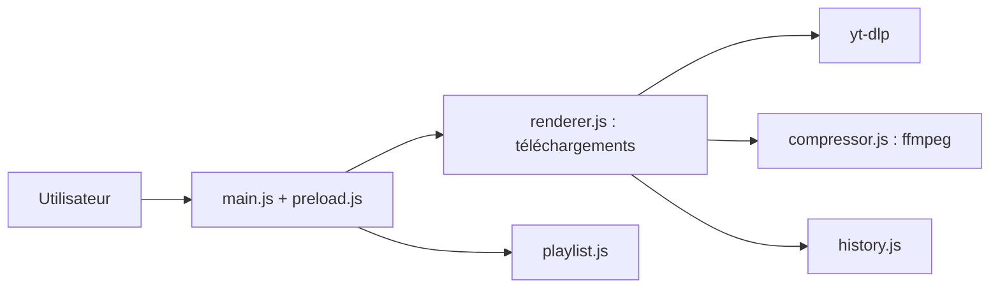

# aandrew-me/ytDownloader

> Electron desktop application to download video and audio from hundreds of sites.

## The problem
Downloading videos, playlists or audio tracks with yt-dlp on the command line is impractical for a non-technical person.

## What it actually does
Graphical interface on top of yt-dlp and ffmpeg: single or playlist download, format choice, time range, subtitles, video compressor with hardware acceleration, history and preferences. Installation via Microsoft Store, Chocolatey, Scoop, Winget, Flatpak, AppImage or Snap. No trackers or ads according to the README.

## How it is wired


## Trying it
```bash
flatpak install flathub io.github.aandrew_me.ytdn
winget install aandrew-me.ytDownloader
git clone https://github.com/aandrew-me/ytDownloader.git
cd ytDownloader
npm i
npm start
```

## Cost and gotchas
Free. On macOS, the app is unsigned (`xattr` command required) and `yt-dlp` must be installed via Homebrew. To build, ffmpeg must be placed at the root.

## What it is not
It is an interface, not an engine: supported sites depend on yt-dlp. Downloading protected content is subject to local law.

## Alternatives
- No alternative named in the README.

## For you
Worth watching: convenient for building a small local audio/video corpus, but yt-dlp in a script is easier to automate.
