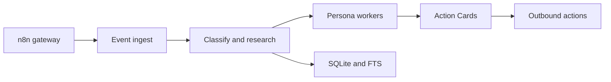

# aayushch/laya

> Local command center that aggregates work notifications and prepares action cards that an LLM drafts and you approve.

## The problem
Slack, Gmail, GitHub, Jira, Notion and calendar notifications arrive in a jumble; replying means hunting for context each time.

## What it actually does
A Tauri/Svelte desktop app drives a Python FastAPI engine. n8n normalizes the events, the engine classifies them, researches them through LLM personas (engineer, comms, ops...) and proposes action cards. Once approved, n8n executes (PRs, replies). Storage is SQLite and ChromaDB, with the LLM via LiteLLM (Ollama, LM Studio, Claude, GPT, Gemini) or CLI agents. Includes rule learning, cost budgets and hybrid search.

## How it is wired


## Trying it
```bash
scripts/setup-dev.sh
scripts/dev.sh
scripts/build.sh
```

## Cost and gotchas
Installable versions are on the Releases page; the cloud LLM is pay-as-you-go (monthly caps available). Windows ARM and some Linux setups need documented workarounds (AppImage, npm 12). Do not run `pip install laya`: it is a different package.

## What it is not
Not a simple passive aggregator: it can send messages and PRs after your approval. A rich README, but little evidence of long-term robustness.

## Alternatives
No alternative named in the README.

## For you
Worth watching: good local-first architecture with local LLMs possible, but a young project (created in May 2026) and many connectors to configure.
