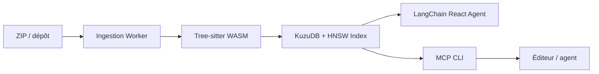

# abhigyanpatwari/GitNexus

> Indexes a repository into a graph of symbols and calls, exposed to code agents via MCP.

## The problem
A code agent can't see who calls what: it modifies a function without measuring what the change breaks.

## What it actually does
`gitnexus analyze` builds a local index without an LLM (tree-sitter, graph database, vector search). The MCP tools `query`, `context`, `impact`, `trace`, `detect_changes` and `rename` query this graph. `setup` configures Claude Code, Cursor, Codex and other editors. A web interface (`gitnexus serve`) lets you browse the indexes.

## How it is wired


## Trying it
```bash
npx gitnexus analyze
npx gitnexus setup
gitnexus query "authentication"
gitnexus impact UserService --direction upstream
```

## Cost and gotchas
Free locally; remote embeddings, wiki and AI chat use the providers you configure (API key at your expense). `analyze` writes `AGENTS.md` / `CLAUDE.md` and hooks into the repository, unless `--index-only` is used.

## What it is not
Not a complete review tool: resolution depends on the language and the README asks you to check ambiguities and index freshness. The PR Review, multi-repo and OCaml features belong to the enterprise offering.

## Alternatives
No alternative named in the README.

## For you
Worth watching: useful for giving structural context to an agent, but the unidentified license and the commercial offering require reading the LICENSE file before any professional use.
