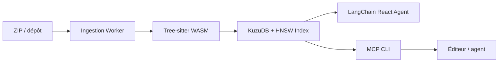

# abhigyanpatwari/GitNexus

> Indexe un dépôt en graphe de symboles et d'appels, exposé aux agents de code via MCP.

## Le problème
Un agent de code ne voit pas qui appelle quoi : il modifie une fonction sans mesurer ce que le changement casse.

## Ce que ça fait vraiment
`gitnexus analyze` construit un index local sans LLM (tree-sitter, base graphe, recherche vectorielle). Les outils MCP `query`, `context`, `impact`, `trace`, `detect_changes` et `rename` interrogent ce graphe. `setup` configure Claude Code, Cursor, Codex et d'autres éditeurs. Une interface web (`gitnexus serve`) permet de parcourir les index.

## Comment c'est branché


## Essayer
```bash
npx gitnexus analyze
npx gitnexus setup
gitnexus query "authentication"
gitnexus impact UserService --direction upstream
```

## Coût et pièges
Gratuit en local ; embeddings distants, wiki et chat IA utilisent les fournisseurs que tu configures (clé d'API à ta charge). `analyze` écrit `AGENTS.md` / `CLAUDE.md` et des hooks dans le dépôt, sauf `--index-only`.

## Ce que ce n'est pas
Pas un outil de revue complet : la résolution dépend du langage et le README demande de vérifier ambiguïtés et fraîcheur de l'index. Les fonctions PR Review, multi-dépôts et OCaml relèvent de l'offre entreprise.

## Alternatives
Aucune alternative nommée dans le README.

## Pour toi
À surveiller : utile pour donner du contexte structurel à un agent, mais la licence non identifiée et l'offre commerciale imposent de lire le fichier LICENSE avant tout usage pro.

