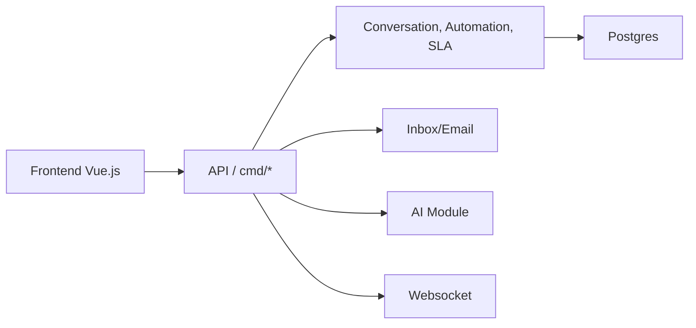

# abhinavxd/libredesk

> Self-hosted customer service in a single binary: email and chat inbox, knowledge base, AI.

## The problem
Centralize customer emails and chats in a shared inbox without paying for a support SaaS.

## What it actually does
Go backend and Vue 3 frontend (Shadcn), PostgreSQL and Redis. Omnichannel inbox, chat widget, multilingual help center, AI assistant backed by the knowledge base with handoff to a human, agent copilot, automations, macros, SLAs, CSAT, SSO (Google, Microsoft, OIDC), API and webhooks, activity logs.

## How it is wired


## Trying it
```bash
curl -LO https://github.com/abhinavxd/libredesk/raw/main/docker-compose.yml
curl -LO https://github.com/abhinavxd/libredesk/raw/main/config.sample.toml
cp config.sample.toml config.toml
docker compose up -d
docker exec -it libredesk_app ./libredesk --set-system-user-password
```

## Cost and gotchas
Free; Postgres and Redis must be provided (Railway does it in one click). The AI assistant's provider is not specified in the README. AGPL-3.0. 90 open issues.

## What it is not
Not a data/AI tool: a help desk, whose assistant is only an option.

## Alternatives
Not documented in the README.

## For you
Ignore: customer support domain unrelated to your work, and a single maintainer.
