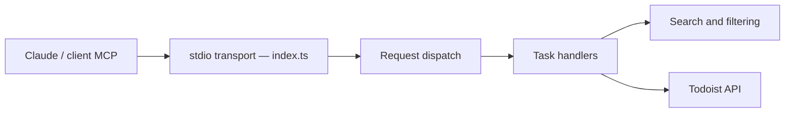

# abhiz123/todoist-mcp-server

> MCP server that lets Claude create, search, update and delete Todoist tasks.

## The problem
Managing your Todoist tasks from a conversation with Claude is not possible without an integration.

## What it actually does
An MCP server (stdio, a single `index.ts` file) exposes five tools: creation, reading with filters (date, priority, project), update, completion and deletion. For the last three, it finds the task by partial name match, then calls the Todoist API.

## How it is wired


## Trying it
```bash
npm install -g @abhiz123/todoist-mcp-server
npx -y @smithery/cli install @abhiz123/todoist-mcp-server --client claude
```
Then add the server to `claude_desktop_config.json` with `TODOIST_API_TOKEN`.

## Cost and gotchas
Free; requires a Todoist account and its API token. Last push in April 2025: more than a year old.

## What it is not
Partial name matching can target the wrong task before deletion or completion. No project or label management documented beyond the filters.

## Alternatives
No alternative named in the README.

## For you
Worth watching: simple and readable as an example of an MCP server, but little maintained; read it through before entrusting it with your token.
