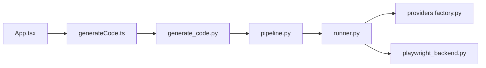

# abi/screenshot-to-code

> Turns a screenshot, a mockup or a recording into web code, self-hosted.

## The problem
Recreating by hand in HTML, React or Vue an interface seen in an image takes time for the first layout.

## What it actually does
A React/Vite (frontend) and FastAPI (backend) application sends the image to a model (OpenAI, Anthropic or Gemini) and returns code for HTML+Tailwind, React, Vue, Bootstrap or Ionic. An agent loops with tools, can render the page in Chromium (Playwright) to review itself, and Replicate is used to generate or edit images. Cost tracking and evaluations exist on the backend side.

## How it is wired


## Trying it
```bash
cd backend
echo "OPENAI_API_KEY=sk-your-key" > .env
poetry install
poetry run uvicorn main:app --reload --port 7001
cd ../frontend
pnpm install
pnpm dev
```

## Cost and gotchas
At least one API key (OpenAI, Anthropic or Gemini); Gemini and Replicate recommended. Each generation is billed by the provider. Docker version: `docker-compose up -d --build`, without hot reload.

## What it is not
Not offline generation: Ollama is mentioned but discouraged (poor results). An official hosted version exists.

## Alternatives
No alternative named in the README (official hosted product: screenshottocode.com).

## For you
Watch: useful as an example of a multimodal agent with evaluations, but outside your core work and pay-per-use.
