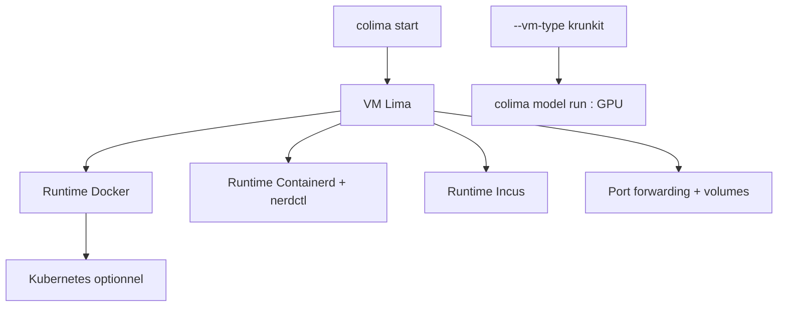

# abiosoft/colima

> Container runtimes on macOS and Linux, with a Lima VM and minimal configuration.

## The problem
Running Docker on macOS requires a VM, port forwarding and volume mounts to configure.
Switching between Docker, containerd and local Kubernetes normally requires three different tools.

## What it actually does
Starts a preconfigured Lima VM exposing a container runtime, with automatic port forwarding, volume mounts and multiple instances.
Runtimes of your choice: Docker (with optional Kubernetes), Containerd (with optional Kubernetes), Incus for containers and virtual machines.
`colima start --kubernetes` gives a local cluster; images built or pulled with Docker are directly accessible there (with Containerd, via the `k8s.io` namespace).
GPU-accelerated containers for AI workloads with the `krunkit` VM type (Apple Silicon, macOS 13+), and `colima model run` behind Docker Model Runner or Ramalama (Docker AI, HuggingFace, Ollama registries).

## How it is wired


## Trying it
```sh
brew install colima
colima start
docker run hello-world
colima start --runtime containerd
colima start --cpu 4 --memory 8
colima start --runtime docker --vm-type krunkit
colima model run gemma3
```

## Cost and gotchas
Free. The default VM has 2 CPUs, 2 GiB of memory and 100 GiB of storage: increase it for serious use (the disk can grow after creation, not shrink).
The client (`docker`, `kubectl`, `incus`, `krunkit`) is not provided: to be installed separately.

## What it is not
It is not a container engine: it is a startup layer on top of Lima and existing runtimes.
It is not a graphical interface: everything goes through the CLI and a configuration file.
Incus virtual machines only work on Apple Silicon m3 or newer.

## Alternatives
- Lima — the underlying building block; Colima is only the container-oriented startup layer.

## For you
The simplest way to have Docker and a local Kubernetes on a Mac, GPU included for models.
