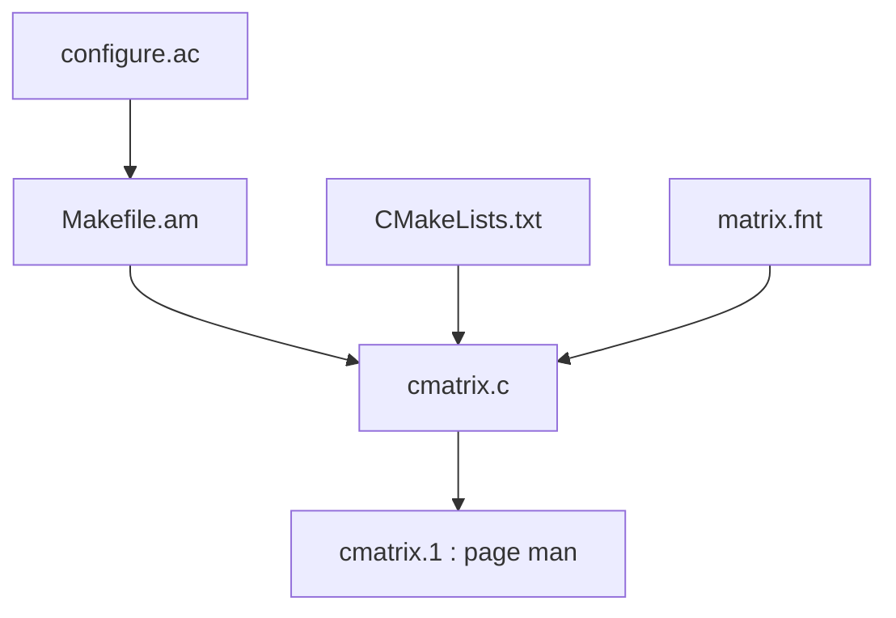

# abishekvashok/cmatrix

> Small program that reproduces the Matrix movie's falling character rain in the terminal.

## The problem
No practical need: it is a terminal screensaver, just for fun.

## What it actually does
A single C program (`cmatrix.c`) built on ncurses displays scrolling characters, with adjustable speed and color, in synchronous or asynchronous mode. Options reproduce the look of the movie or of the Windows and macOS screensaver. It is built with autotools or CMake and ships a man page and an RPM package template.

## How it is wired


## Trying it
```bash
autoreconf -i
./configure
make
make install
cmatrix -ba -u 2 -C red
```

## Cost and gotchas
Free. Requires an ncurses library. The CMake build does not work on Windows for now. Last push in August 2024, so more than a year ago. GPL-3.0 license.

## What it is not
It is not a work tool. The README states that it is probably neither very portable nor very efficient.

## Alternatives
No alternative named in the README.

## For you
Ignore: a decorative gadget, unrelated to your job, and rarely updated.
