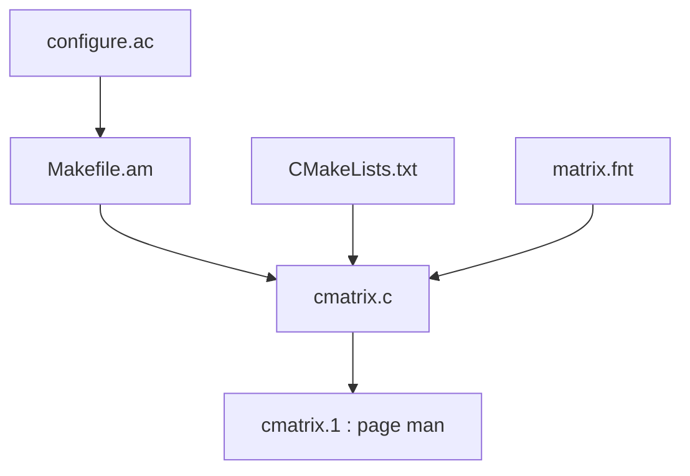

# abishekvashok/cmatrix

> Petit programme qui reproduit dans le terminal la pluie de caractères du film Matrix.

## Le problème
Aucun besoin pratique : c'est un économiseur d'écran de terminal pour le plaisir.

## Ce que ça fait vraiment
Un programme C unique (`cmatrix.c`) basé sur ncurses affiche des caractères qui défilent, à vitesse et couleur réglables, de façon synchrone ou asynchrone. Des options reproduisent l'aspect du film ou de l'économiseur Windows et macOS. Il se compile par autotools ou CMake et fournit une page man et un modèle de paquet RPM.

## Comment c'est branché


## Essayer
```bash
autoreconf -i
./configure
make
make install
cmatrix -ba -u 2 -C red
```

## Coût et pièges
Gratuit. Nécessite une bibliothèque ncurses. La version CMake ne fonctionne pas sous Windows pour l'instant. Dernier push en août 2024, donc plus d'un an. Licence GPL-3.0.

## Ce que ce n'est pas
Ce n'est pas un outil de travail. Le README précise qu'il n'est probablement ni très portable ni très efficace.

## Alternatives
Aucune alternative nommée dans le README.

## Pour toi
À ignorer : gadget décoratif, sans lien avec ton métier, et peu mis à jour.

