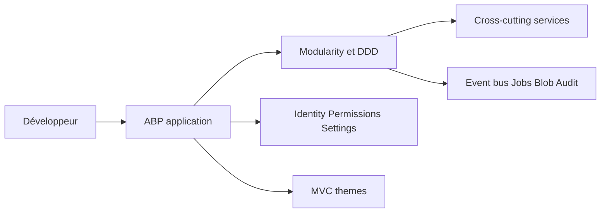

# abpframework/abp

> Modular .NET framework for enterprise applications: DDD, multi-tenant, ready-to-use modules.

## The problem
.NET business applications repeat the same infrastructure: identity, tenants, audit logs, background jobs, events.

## What it actually does
Architecture layer on top of ASP.NET Core: modularity and DDD, current tenant, validation, authorization, cache, event bus, background jobs, blob storage, template rendering. Modules (Account, Identity, OpenIddict, SaaS, CMS Kit), UI themes, starter templates, CLI, ABP Studio and ABP Suite.

## How it is wired

## Trying it
No command documented in the README: Getting Started guides and the CLI tool are cited.

## Cost and gotchas
The framework is free under LGPL-3.0; ABP Studio and ABP Suite are separate tools, some paid (not detailed).

## What it is not
Not a no-code tool: it imposes an opinionated architecture.

## Alternatives
No alternative named in the README.

## For you
Ignore: specific to enterprise .NET applications, with no link to data/AI.
