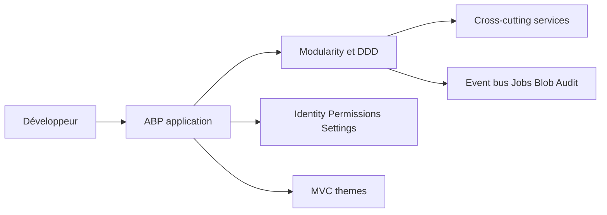

# abpframework/abp

> Framework .NET modulaire pour applications d'entreprise : DDD, multi-tenant, modules prêts à l'emploi.

## Le problème
Les applications métier .NET répètent la même infrastructure : identité, tenants, journaux d'audit, tâches de fond, événements.

## Ce que ça fait vraiment
Couche d'architecture au-dessus d'ASP.NET Core : modularité et DDD, locataire courant, validation, autorisation, cache, bus d'événements, tâches de fond, stockage de blobs, rendu de modèles. Modules (Account, Identity, OpenIddict, SaaS, CMS Kit), thèmes UI, modèles de démarrage, CLI, ABP Studio et ABP Suite.

## Comment c'est branché

## Essayer
Aucune commande documentée dans le README : guides Getting Started et outil CLI cités.

## Coût et pièges
Le framework est gratuit en LGPL-3.0 ; ABP Studio et ABP Suite sont des outils séparés, certains payants (non détaillé).

## Ce que ce n'est pas
Pas un outil sans code : il impose une architecture opinionnée.

## Alternatives
Aucune alternative nommée dans le README.

## Pour toi
Ignorer : spécifique aux applications .NET d'entreprise, sans lien avec data/IA.

