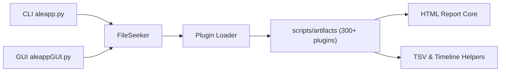

# abrignoni/ALEAPP

> Forensic analyzer of Android extractions (logs, events, protobuf), for digital investigators.

## The problem
A raw Android extraction is a heap of databases and files; you need per-application extractors to build a timeline from it.

## What it actually does
Reads an extraction (zip, tar, gz, folder or raw disk image) and loads artifact plugins: the README reports more than 300 modules. Each module produces HTML reports, TSV and a timeline. Disk images are read without mounting (EWF, AFF, VMDK, APFS, LUKS, BitLocker...) with password entry. Graphical interface and command line. The prebuilt binaries avoid installing Python.

## How it is wired


## Trying it
```bash
python aleapp.py -t <zip | tar | fs | gz | raw> -i <path_to_extraction> -o <path_for_report_output>
python aleappGUI.py
python aleapp.py --help
pip3 install -r requirements.txt
```

## Cost and gotchas
Free; Python 3.10+ (`tkinter` separately on Linux) or a prebuilt binary. The output folder must already exist. `.tar.gz` archives are decompressed into the report folder: plan for disk space. Windows builds are not signed.

## What it is not
Not an acquisition tool: it analyzes extractions that have already been made. Committed test data becomes public: never put business data in it. The provided diagram is generic and mentions Python 3.9, whereas the README requires 3.10.

## Alternatives
No alternative named in the README (it mentions the LEAPP family).

## For you
Worth watching: a reference for Android forensic analysis, but outside the usual data/AI scope; useful if you do investigation work.
