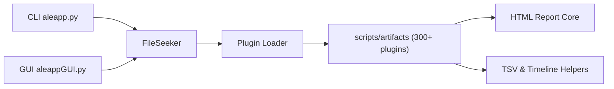

# abrignoni/ALEAPP

> Analyseur forensique d'extractions Android (journaux, événements, protobuf), pour enquêteurs numériques.

## Le problème
Un extraction Android brute est un amas de bases et de fichiers ; il faut des extracteurs par application pour en tirer une chronologie.

## Ce que ça fait vraiment
Lit une extraction (zip, tar, gz, dossier ou image disque brute) et charge des plugins d'artefacts : le README fait état de plus de 300 modules. Chaque module produit des rapports HTML, TSV et chronologie. Les images disques sont lues sans montage (EWF, AFF, VMDK, APFS, LUKS, BitLocker…) avec saisie de mot de passe. Interface graphique et ligne de commande. Les binaires pré-compilés évitent d'installer Python.

## Comment c'est branché


## Essayer
```bash
python aleapp.py -t <zip | tar | fs | gz | raw> -i <path_to_extraction> -o <path_for_report_output>
python aleappGUI.py
python aleapp.py --help
pip3 install -r requirements.txt
```

## Coût et pièges
Gratuit ; Python 3.10+ (`tkinter` à part sous Linux) ou binaire pré-construit. Le dossier de sortie doit déjà exister. Les compresses `.tar.gz` sont décompressées dans le dossier de rapport : prévoir de l'espace. Les builds Windows ne sont pas signés.

## Ce que ce n'est pas
Pas un outil d'acquisition : il analyse des extractions déjà faites. Les données de test commitées deviennent publiques : n'y mets jamais de données d'affaire. Le diagramme fourni est générique et mentionne Python 3.9, alors que le README exige 3.10.

## Alternatives
Aucune alternative nommée dans le README (il évoque la famille LEAPP).

## Pour toi
À surveiller : référence pour l'analyse forensique Android, mais hors périmètre data/IA habituel ; utile si tu fais de l'investigation.

