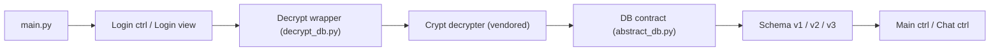

# absadiki/whatsapp-msgstore-viewer

> Desktop application that decrypts and displays the WhatsApp msgstore.db database, for personal use.

## The problem
Reading a backed-up WhatsApp conversation history requires decrypting the database and then browsing it.

## What it actually does
Kivy interface in MVC (login, list and conversation screens). The decryption module bundles a third-party decrypter for crypt12/14/15; it writes a `-decrypted.db` copy. Database schemas are versioned plugins (`dbs/v1` to `v3`); wa.db and the media folder are optional.

## How it is wired


## Trying it
```bash
git clone https://github.com/absadiki/whatsapp-msgstore-viewer
cd whatsapp-msgstore-viewer
pip install -e .
wmv
```

## Cost and gotchas
Python 3.9+; system dependencies possible on Ubuntu. You must own the database and the decryption key. Reverse engineering tested on the author's database: a WhatsApp schema change can break the tool.

## What it is not
Not endorsed by WhatsApp; "personal and educational use". Not meant for recovering the key or the databases (points to an external tutorial).

## Alternatives
No alternative cited in the README.

## For you
Ignore: a personal-data reading tool, off-topic for data / AI work, under GPL-3.0 and maintained by one person.
