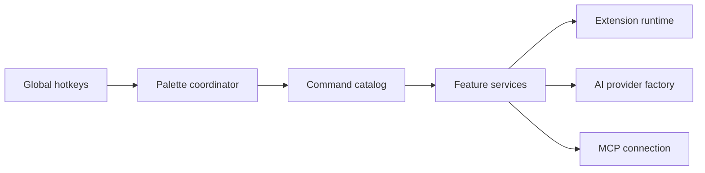

# abue-ammar/tinycast

> Native macOS launcher in Swift, Raycast-style, that also runs real Raycast extensions.

## The problem
Rich command launchers are heavy (Electron) or closed.

## What it actually does
A palette with a global hotkey: app launching, file search (Spotlight), clipboard history, calculator/conversions, snippets, window management (34 actions), Markdown notes, calendar, Apple shortcuts, shell commands. AI chat and quick actions are disabled by default and use your key or an account. Runs Raycast extensions through an embedded JavaScript runtime and renders in SwiftUI. MCP servers supported.

## How it is wired


## Trying it
```bash
brew trust --tap abue-ammar/tinycast
brew tap abue-ammar/tinycast
brew install --cask tinycast
```

## Cost and gotchas
Free, macOS 26+ only, self-signed application (quarantine flag to remove if installed via DMG). Accessibility permission required to paste and expand snippets. Repository created in June 2026: very young.

## What it is not
Not a complete Raycast clone; extension compatibility is claimed but not measured here. The badge says AGPL-3.0, but GitHub does not identify it.

## Alternatives
None named in the README (Raycast and Rectangle cited as references).

## For you
Keep an eye on it: interesting for a developer's Mac, but a new project carried by one person.
