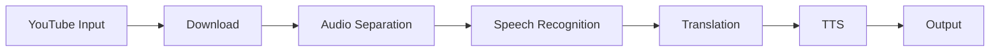

# abus-aikorea/voice-pro

> Gradio WebUI for dubbing: YouTube download, transcription, translation, voice cloning.

## The problem
Subtitling, translating and dubbing a video takes several tools or a SaaS billed per minute.

## What it actually does
Download via yt-dlp, voice separation (Demucs), Whisper/Faster-Whisper transcription.
Translation with Deep-Translator (or Azure with your keys), Edge-TTS synthesis, kokoro, zero-shot cloning with F5-TTS, E2-TTS, CosyVoice.
Tabs for Dubbing Studio, Whisper Caption, Translate, Speech Generation; live translation.

## How it is wired


## Trying it
```bash
git clone https://github.com/abus-aikorea/voice-pro.git
```

## Cost and gotchas
Free; NVIDIA GPU with 4 GB+ (8 GB recommended), ~10 GB of models, 20 GB of disk. Azure optional at your expense.

## What it is not
Development is paused (the team is on WeConnect). Inconsistent license: GPL-3.0 in the catalog, LGPL in the header. Celebrity voices are offered: legal risk.

## Alternatives
SaaS platforms are listed (Maestra, Kapwing, HappyScribe, Descript...), not repositories: no repository alternative named.

## For you
Ignore: an unmaintained end-to-end tool; the Whisper/F5-TTS building blocks are better used directly.
