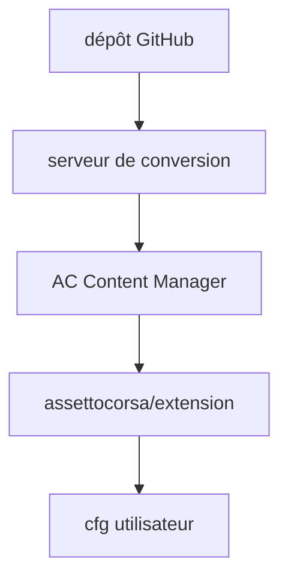

# ac-custom-shaders-patch/acc-extension-config

> Configuration files for Assetto Corsa's Custom Shaders Patch: lights, tyres, weather.

## The problem
The patch needs per-car and per-track settings (lights, precomputed shadows) to be useful.

## What it actually does
A repository of configurations: car and track lights, per-vertex ambient occlusion fixes, default weather implementation and controller. A server converts them every 5 minutes for download through Content Manager. The `.ini` settings take effect in game.

## How it is wired
Simplified diagram based on the sheet, no diagram provided.

## Trying it
No command: install through Content Manager (Settings, Custom Shaders Patch) or extract the repository ZIP so that `tzdata` ends up in `assettocorsa/extension`.

## Cost and gotchas
Assumes Assetto Corsa and Custom Shaders Patch. Some track configs require additional `.kn5` files. License: none declared.

## What it is not
Not the patch itself: these are its configuration files.

## Alternatives
No alternative named in the README.

## For you
Ignore: configurations for a racing game, off-topic for data/AI/MLOps.
