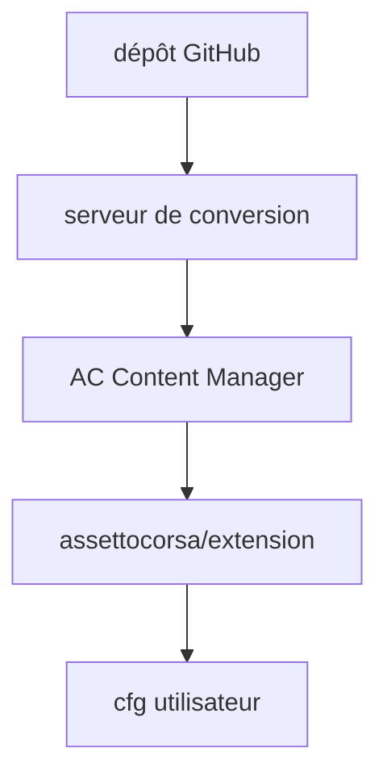

# ac-custom-shaders-patch/acc-extension-config

> Fichiers de configuration du Custom Shaders Patch d'Assetto Corsa : lumières, pneus, météo.

## Le problème
Le patch a besoin de réglages par voiture et par piste (feux, ombres précalculées) pour être utile.

## Ce que ça fait vraiment
Dépôt de configurations : lumières de voitures et de pistes, correctifs d'occlusion ambiante par sommet, implémentation et contrôleur météo par défaut. Un serveur les convertit toutes les 5 minutes pour un téléchargement par Content Manager. Les réglages en `.ini` prennent effet en jeu.

## Comment c'est branché
Schéma simplifié d'après la fiche, sans diagramme fourni.

## Essayer
Aucune commande : installer via Content Manager (Settings, Custom Shaders Patch) ou extraire le ZIP du dépôt, de sorte que `tzdata` arrive dans `assettocorsa/extension`.

## Coût et pièges
Suppose Assetto Corsa et Custom Shaders Patch. Certaines configs de piste exigent des `.kn5` supplémentaires. Licence : aucune déclarée.

## Ce que ce n'est pas
Pas le patch lui-même : ce sont ses fichiers de configuration.

## Alternatives
Aucune alternative nommée dans le README.

## Pour toi
Ignorer : configurations pour un jeu de course, hors sujet data/IA/MLOps.

