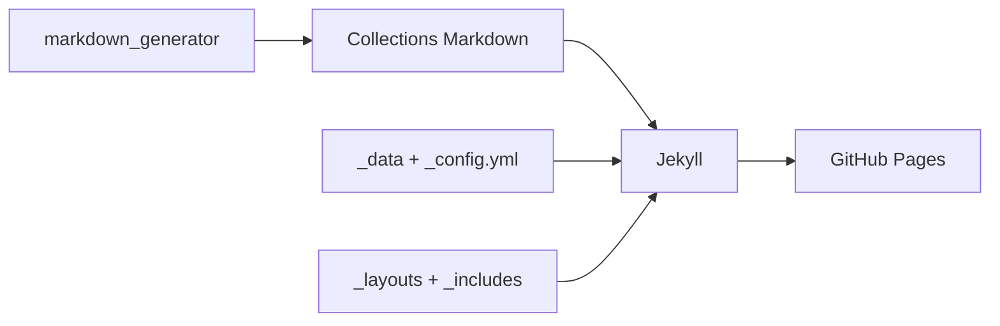

# academicpages/academicpages.github.io

> Jekyll template for an academic personal website hosted on GitHub Pages: publications, talks, CV.

## The problem
A researcher wants a simple, versioned, free portfolio site without starting from a blank page.

## What it actually does
A GitHub template ("Use this template") derived from the Minimal Mistakes theme. Content is in Markdown in collections (`_publications`, `_talks`, `_teaching`, `_portfolio`, `_posts`), configuration in `_config.yml` and `_data/`. Python scripts and notebooks in `markdown_generator/` produce pages from a TSV or BibTeX file; others convert a Markdown CV into JSON. Local preview with Jekyll, Docker or DevContainer.

## How it is wired


## Trying it
```bash
bundle install
jekyll serve -l -H localhost
docker compose up
```

## Cost and gotchas
Free. Ruby, Bundler and Node are needed locally, or Docker. The README warns that syncing a customized site with template updates causes conflicts.

## What it is not
It is not a CMS nor a tool for publishing research results: it is a static site.

## Alternatives
The README cites Minimal Mistakes, the theme it derives from.

## For you
Worth watching: handy for a data project portfolio or a free technical blog, provided you accept Ruby/Jekyll.
