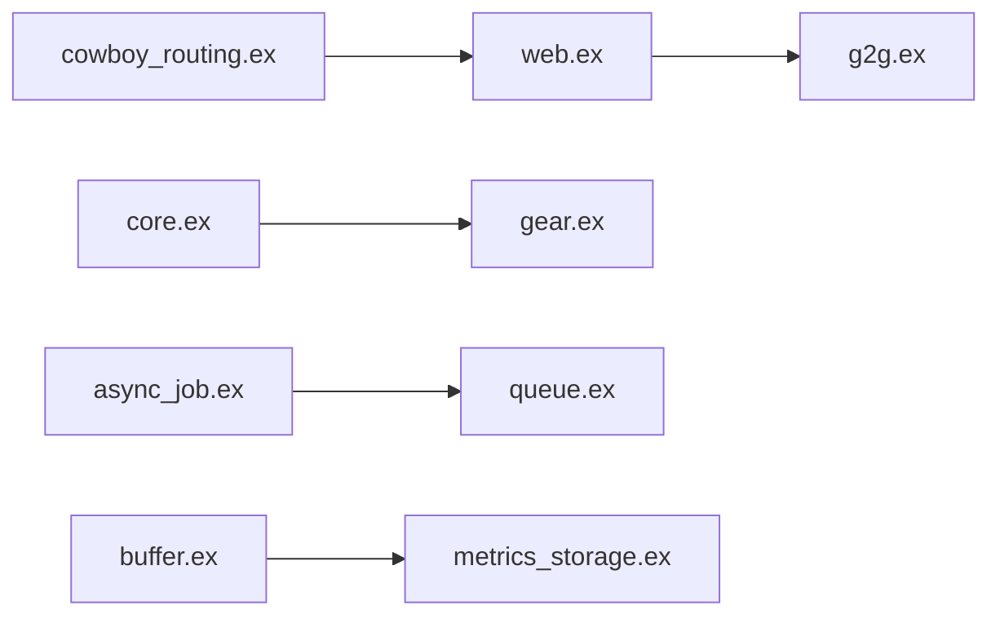

# access-company/antikythera

> Elixir framework for building your own internal PaaS: several web services on a single ErlangVM cluster.

## The problem
Running several small web services is expensive in infrastructure and in network communication between them.

## What it actually does
Each service ("gear") is a separate mix project, co-located in the same Erlang VM. Domain-based routing, HTTP and WebSocket, HAML templates, CDN for static assets, distributed job queues, metrics, alerts, logs, configuration management. Gear-to-gear calls avoid the network. Used in production at ACCESS, but "early stage" according to the README.

## How it is wired

## Trying it
No command in the README: it points to the Getting Started guide.

## Cost and gotchas
Everything must be written in Elixir; administrator docs are "TBD". Missing components according to the README.

## What it is not
Not a Kubernetes: no OS process isolation, only Erlang's process model.

## Alternatives
No alternative named in the README.

## For you
Watch: the nano-services idea is interesting, but Elixir-only and with no direct link to data/AI.
