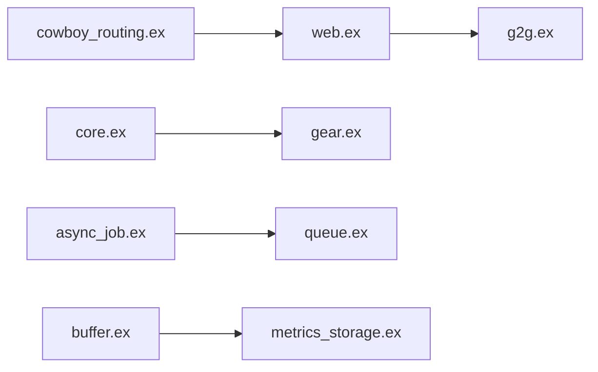

# access-company/antikythera

> Framework Elixir pour monter son propre PaaS interne : plusieurs services web sur un seul cluster ErlangVM.

## Le problème
Exploiter plusieurs petits services web coûte cher en infrastructure et en communication réseau entre eux.

## Ce que ça fait vraiment
Chaque service (« gear ») est un projet mix séparé, co-localisé dans la même VM Erlang. Routage par domaine, HTTP et WebSocket, gabarits HAML, CDN pour les statiques, files de jobs distribuées, métriques, alertes, logs, gestion de configuration. Les appels gear-à-gear évitent le réseau. Utilisé en production chez ACCESS, mais « stade précoce » selon le README.

## Comment c'est branché

## Essayer
Aucune commande dans le README : renvoi au guide Getting Started.

## Coût et pièges
Tout doit être écrit en Elixir ; docs administrateur « TBD ». Composants manquants selon le README.

## Ce que ce n'est pas
Pas un Kubernetes : pas d'isolation de processus OS, seulement le modèle de processus d'Erlang.

## Alternatives
Aucune alternative nommée dans le README.

## Pour toi
À surveiller : l'idée de nano-services est intéressante, mais Elixir-only et sans rapport direct avec data/IA.

