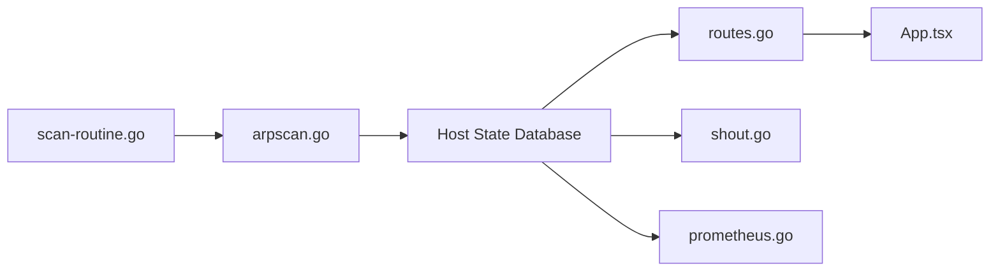

# aceberg/WatchYourLAN

> Local network ARP scanner with web interface, host history and alerts.

## The problem
Knowing which devices connect to your network and being notified when a new one shows up.

## What it actually does
It runs `arp-scan` at regular intervals on the chosen interfaces and keeps the list and history of hosts (SQLite or Postgres).
Notifications via Shoutrrr (Discord, Telegram, Gotify…).
Export to InfluxDB2 or a Prometheus `/metrics` endpoint for Grafana.
Web interface on port 8840, with no built-in authentication.

## How it is wired


## Trying it
```bash
docker run --name wyl -e "IFACES=$YOURIFACE" -e "TZ=$YOURTIMEZONE" --network="host" -v $DOCKERDATAPATH/wyl:/data/WatchYourLAN aceberg/watchyourlan
```

## Cost and gotchas
The `host` network mode is mandatory, so the port is exposed: you must protect it yourself with a firewall or SSO.

## What it is not
Not a security tool or IDS, and no built-in authentication.

## Alternatives
No alternative named in the README.

## For you
Ignore: it is a homelab tool unrelated to data or AI, and the last push is more than a year old.
