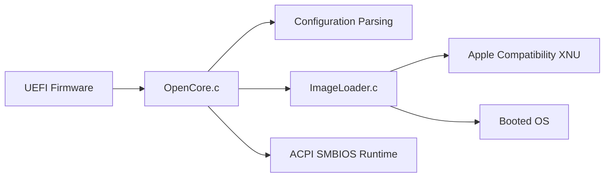

# acidanthera/OpenCorePkg

> OpenCore UEFI bootloader and library SDK for Apple-oriented firmware.

## The problem
Boot macOS or other systems on non-Apple hardware, with kext injection, ACPI/SMBIOS patches and secure boot support.

## What it actually does
The UEFI firmware launches `OpenCore.c`: it reads the configuration (plist), shows a selection menu, loads the image, applies compatibility and security fixes, then boots the system. The libraries provide Apple disk image loading, SMBIOS/ACPI, crypto, decompression, PNG, HDA audio and an XNU injection engine.

## How it is wired

## Trying it
No command documented in the README: refer to the discussion forums and the project documentation.

## Cost and gotchas
Free, but low-level: a wrong configuration can prevent booting.

## What it is not
Not a turnkey installer: it is a bootloader and an SDK for firmware developers.

## Alternatives
Chameleon and Clover are cited as historical predecessors.

## For you
Ignore: firmware topic outside data/AI, relevant only for a hackintosh.
