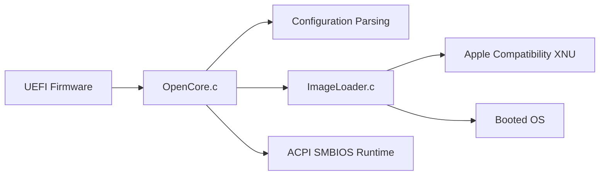

# acidanthera/OpenCorePkg

> Chargeur de démarrage UEFI OpenCore et SDK de bibliothèques pour firmwares orientés Apple.

## Le problème
Démarrer macOS ou d'autres systèmes sur du matériel non Apple, avec injection de kexts, patchs ACPI/SMBIOS et prise en charge du démarrage sécurisé.

## Ce que ça fait vraiment
Le firmware UEFI lance `OpenCore.c` : lecture de la configuration (plist), menu de choix, chargement de l'image, application de correctifs de compatibilité et de sécurité, puis démarrage du système. Les bibliothèques fournissent chargement d'images disque Apple, SMBIOS/ACPI, crypto, décompression, PNG, audio HDA et un moteur d'injection XNU.

## Comment c'est branché

## Essayer
Aucune commande documentée dans le README : se reporter aux forums de discussion et à la documentation du projet.

## Coût et pièges
Gratuit, mais bas niveau : une mauvaise configuration peut empêcher de démarrer.

## Ce que ce n'est pas
Pas un installateur clé en main : c'est un chargeur et un SDK pour développeurs de firmware.

## Alternatives
Chameleon et Clover sont cités comme héritage historique.

## Pour toi
Ignorer : sujet firmware hors data/IA, pertinent seulement pour un hackintosh.

