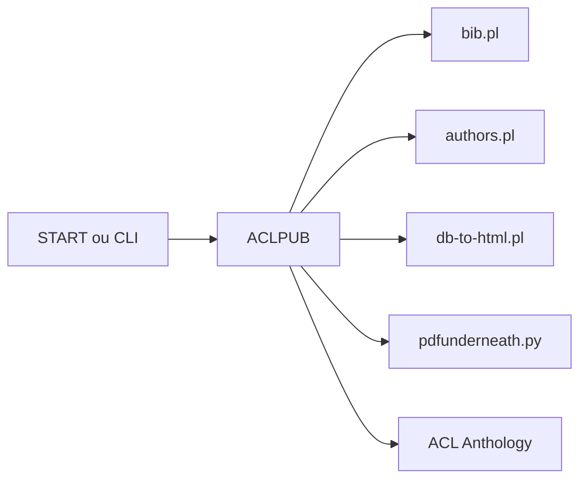

# acl-org/ACLPUB

> Official package that prepares PDFs and BibTeX of ACL conferences for ingestion by the ACL Anthology.

## The problem
Publication chairs must assemble proceedings, metadata and ancillary files into a format the Anthology accepts.

## What it actually does
Scripts (Perl, plus a Python PDF overlay utility) for BibTeX, authors, program, table of contents and HTML generation, along with templates, copyright forms and guides (Anthology, formatting, ordering, START). Usable through Softconf's START or from the command line.

## How it is wired

## Trying it
No command documented in the README: see `docs/`.

## Cost and gotchas
No license: usage rights not established. The `start` branch is synchronized with `master` at intervals.

## What it is not
Not a tool for reviewing or submitting papers.

## Alternatives
No alternative named in the README.

## For you
Ignore: only useful if you organize an ACL conference, not for data/AI/MLOps.
