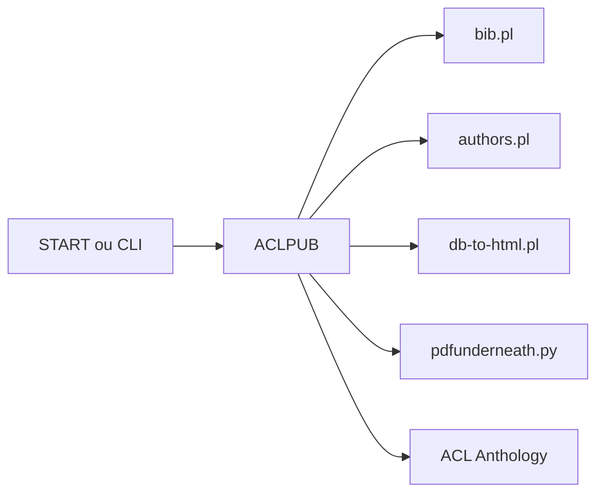

# acl-org/ACLPUB

> Paquet officiel qui prépare PDF et BibTeX des conférences ACL pour l'ingestion par l'ACL Anthology.

## Le problème
Les chairs de publication doivent assembler actes, métadonnées et fichiers annexes dans un format que l'Anthology accepte.

## Ce que ça fait vraiment
Scripts (Perl, un utilitaire Python de surimpression PDF) pour BibTeX, auteurs, programme, table des matières et génération HTML, plus gabarits, formulaires de copyright et guides (Anthology, mise en forme, ordre, START). Utilisable via START de Softconf ou en ligne de commande.

## Comment c'est branché

## Essayer
Aucune commande documentée dans le README : voir `docs/`.

## Coût et pièges
Licence absente : droits d'usage non établis. Branche `start` synchronisée sur `master` par intervalles.

## Ce que ce n'est pas
Pas un outil de relecture ni de soumission d'articles.

## Alternatives
Aucune alternative nommée dans le README.

## Pour toi
À ignorer : utile seulement si tu organises une conférence ACL, pas pour data/IA/MLOps.

