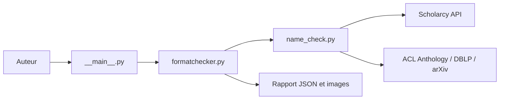

# acl-org/aclpubcheck

> Checks the PDF format of an ACL paper (margins, fonts, authors, citations) before submission.

## The problem
Badly formatted papers cost exchanges with the publication chairs and distract reviewers.

## What it actually does
Analyzes a PDF in the ACL LaTeX style: margins, page numbering, fonts, references. It writes a JSON report and annotated images. The citation check extracts the bibliography through the Scholarcy API and compares it with ACL Anthology, DBLP and arXiv. Tools for chairs validate metadata against Google Sheets.

## How it is wired


## Trying it
```bash
uvx --from git+https://github.com/acl-org/aclpubcheck aclpubcheck --paper_type PAPER_TYPE /path/to/paper.pdf
python3 -m aclpubcheck -p long example/2023.acl-tutorials.1.pdf
```

## Cost and gotchas
Python 3.10+. Run it on the camera-ready version, not the line-numbered version. Citation warnings can be false; the check uses external services.

## What it is not
Does not judge the scientific content, only the form.

## Alternatives
A Colab version and a Hugging Face Space (teelinsan/aclpubcheck) avoid a local install; rebiber fixes bib files.

## For you
Worth adopting if you publish at ACL/NAACL: free, maintained, used by the chairs, and it saves pointless back-and-forth.
