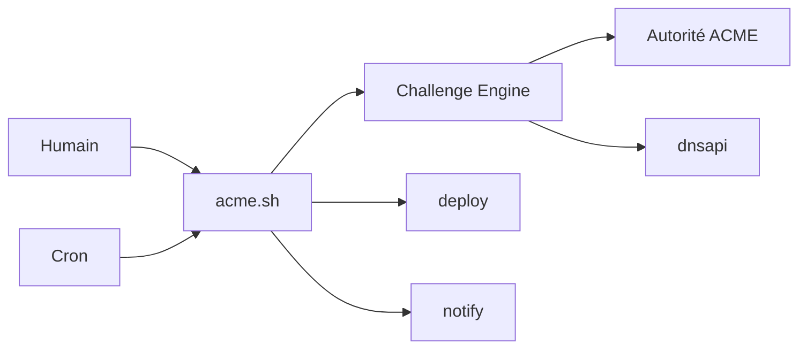

# acmesh-official/acme.sh

> ACME Client, a pure-shell application for issuing, renewing, and installing free TLS certificates.

## The problem
Manually obtaining and renewing HTTPS certificates silently expires existing certificates and causes websites to break.

## What it actually does
A bash, dash, and sh-compatible shell script, without requiring Python or root access. Webroot, standalone, TLS-ALPN, Apache, Nginx, and DNS (API from many providers, manual, persistent) modes. ECDSA or RSA certificates, SAN, and wildcard support. Set up a daily cron task, renew every 30 days or according to the authority's instructions.

## How it is wired


## Trying it
```bash
curl https://get.acme.sh | sh -s email=my@example.com
acme.sh --issue -d example.com -w /var/www/html
acme.sh --install-cert -d example.com --key-file /path/key.pem --fullchain-file /path/cert.pem --reloadcmd "service nginx force-reload"
```

## Cost and gotchas
Free. The command `curl | sh` executes a remote script: verify the tag signature (≥ 3.1.6) if necessary. Without the correct `--reloadcmd` option, the service will not reload the certificate. Do not use the files in `~/.acme.sh/` directly. The manual DNS configuration does not renew automatically. Repository maintained by ZeroSSL.

## What it is not
Not a centralized, multi-server certificate management system.

## Alternatives
No alternative is mentioned in the README (acme-tiny is cited as an inspiration).

## For you
Implement it as soon as you expose a service over HTTPS (e.g., model APIs, dashboards) on your own machine: it's lightweight and has no dependencies.
