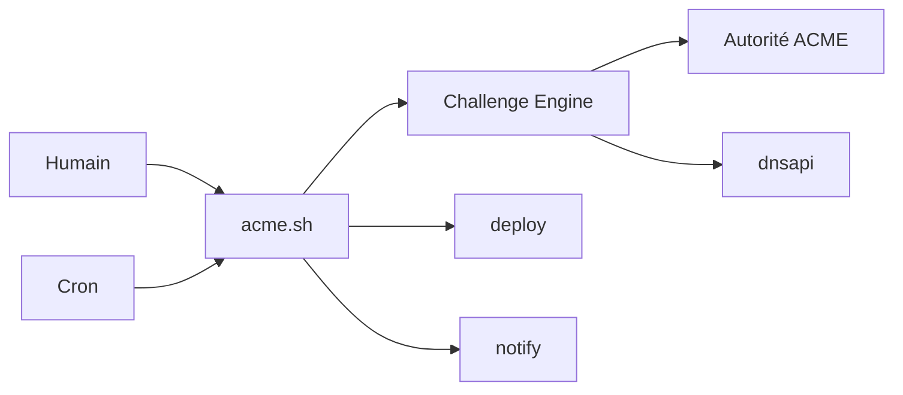

# acmesh-official/acme.sh

> Client ACME en pur shell pour émettre, renouveler et installer des certificats TLS gratuits.

## Le problème
Obtenir et renouveler à la main des certificats HTTPS expire en silence et casse des sites.

## Ce que ça fait vraiment
Un script shell compatible bash, dash et sh, sans Python ni accès root obligatoire. Modes webroot, standalone, TLS-ALPN, Apache, Nginx, DNS (API de nombreux fournisseurs, manuel, persistant). Certificats ECDSA ou RSA, SAN et jokers. Installe une tâche cron quotidienne, renouvelle tous les 30 jours ou selon l'ARI de l'autorité.

## Comment c'est branché


## Essayer
```bash
curl https://get.acme.sh | sh -s email=my@example.com
acme.sh --issue -d example.com -w /var/www/html
acme.sh --install-cert -d example.com --key-file /path/key.pem --fullchain-file /path/cert.pem --reloadcmd "service nginx force-reload"
```

## Coût et pièges
Gratuit. `curl | sh` exécute un script distant : vérifier la signature des tags (≥ 3.1.6) si besoin. Sans `--reloadcmd` correct, le service ne recharge pas le certificat. Ne pas utiliser les fichiers de `~/.acme.sh/` directement. Le mode DNS manuel ne se renouvelle pas seul. Dépôt maintenu par ZeroSSL.

## Ce que ce n'est pas
Pas un gestionnaire de certificats centralisé multi-serveurs.

## Alternatives
Aucune alternative nommée dans le README (acme-tiny est cité comme inspiration).

## Pour toi
À adopter dès que tu exposes un service en HTTPS (API de modèles, dashboards) sur ta propre machine : léger et sans dépendance.

