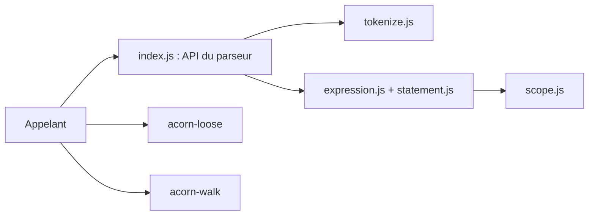

# acornjs/acorn

> Small JavaScript parser written in JavaScript, with an error-tolerant variant and AST walking.

## The problem
Tools that analyze or transform JavaScript need a reliable, lightweight and extensible AST.

## What it actually does
The repository contains three packages: `acorn` (strict parser), `acorn-loose` (error-tolerant parser) and `acorn-walk` (ESTree tree traversal). The plugin system lets you extend the parser (JSX, bigint) via `Parser.extend`, at the price of depending on internals.

## How it is wired


## Trying it
```bash
git clone https://github.com/acornjs/acorn.git
cd acorn
npm install
```

## Cost and gotchas
Free. The catalog indicates that no license was detected on the repository: check before any use. Plugins break when the internals change.

## What it is not
Not a minifier or a transpiler: it only produces the tree. The plugin API is described as "neither clean nor elegant".

## Alternatives
- No alternative named in the README.

## For you
Keep an eye on it: a building block if you analyze JavaScript code (e.g. for code agents), but check the license first.
