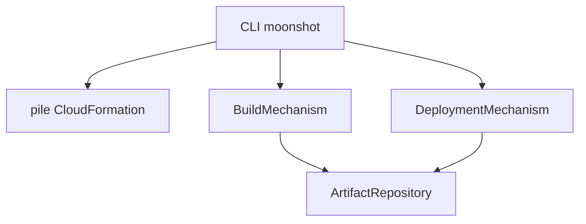

# acquia/moonshot

> Command-line Ruby gem to provision AWS environments around a CloudFormation stack.

## The problem
Delivering a service on AWS requires linking infrastructure, build and artifact storage in a consistent way.

## What it actually does
An environment is centered on a single CloudFormation stack, with pluggable systems: a deployment mechanism, a build mechanism and an artifact repository. The README states three goals: simplicity, choice, verbosity. Limits: no detailed log of sub-stacks and no remote CloudFormation file.

## How it is wired
Simplified diagram based on the sheet, no diagram provided.


## Trying it
```bash
gem install moonshot
```

## Cost and gotchas
AWS account (resources billed to you) and Ruby 2.2 or later. You must write your own configuration following the `sample` folder.

## What it is not
Not a turnkey tool: it is an extensible library to adapt.

## Alternatives
No alternative named in the README.

## For you
Watch: AWS deployment approach via CloudFormation, but in everyday MLOps other infrastructure tools are more widespread.
