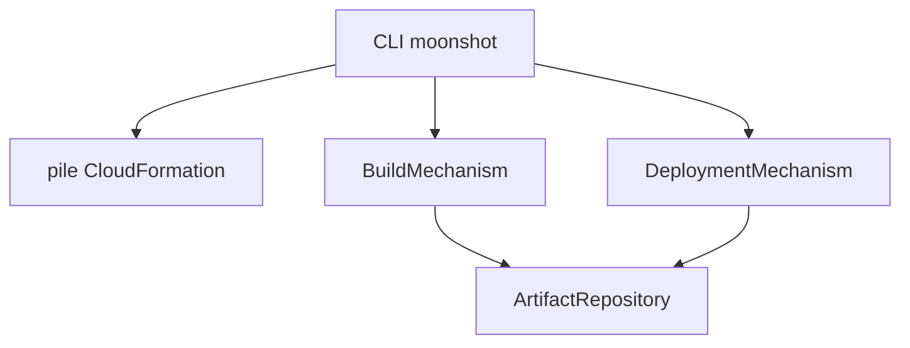

# acquia/moonshot

> Gem Ruby en ligne de commande pour provisionner des environnements AWS autour d'une pile CloudFormation.

## Le problème
Livrer un service sur AWS demande de relier infrastructure, construction et dépôt d'artefacts de façon cohérente.

## Ce que ça fait vraiment
Un environnement se centre sur une seule pile CloudFormation, avec des systèmes enfichables : un mécanisme de déploiement, un mécanisme de construction et un dépôt d'artefacts. Le README annonce trois objectifs : simplicité, choix, verbosité. Limites : pas de journal détaillé des sous-piles et pas de fichier CloudFormation distant.

## Comment c'est branché
Schéma simplifié d'après la fiche, sans diagramme fourni.


## Essayer
```bash
gem install moonshot
```

## Coût et pièges
Compte AWS (ressources facturées à ta charge) et Ruby 2.2 ou plus. Il faut écrire sa propre configuration en suivant le dossier `sample`.

## Ce que ce n'est pas
Pas un outil clé en main : c'est une bibliothèque extensible à adapter.

## Alternatives
Aucune alternative nommée dans le README.

## Pour toi
À surveiller : approche de déploiement AWS par CloudFormation, mais en MLOps courant d'autres outils d'infrastructure sont plus répandus.

