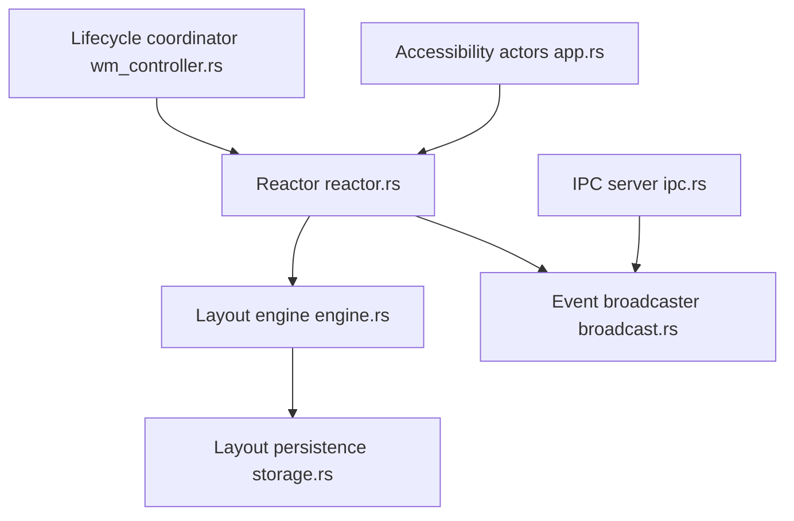

# acsandmann/rift

> Tiling window manager for macOS, without disabling SIP, for i3 or bspwm users.

## The problem
Existing macOS window managers require disabling SIP, don't animate, or handle multiple displays with separate Spaces poorly.

## What it actually does
Several layouts (tiling, BSP, master-stack, scrolling columns, stack), menu bar icon, saving and restoring layouts, hot-reloaded configuration, IPC via Mach ports for third-party programs. Written in Rust, uses private macOS APIs.

## How it is wired

## Trying it
No command in the README; it points to the online documentation (quick start and configuration).

## Cost and gotchas
Free. Rust, presumably to be compiled (not documented in the README). Depends on private macOS APIs: risk of breakage with every system update.

## What it is not
Not a cross-platform tool: macOS only. Not related to data / AI work. Derived from glide-wm, license to be verified.

## Alternatives
Aerospace (cited as a starting point), yabai (source of the private APIs).

## For you
Ignore: a macOS workstation comfort, with no effect on data / AI / MLOps work.
