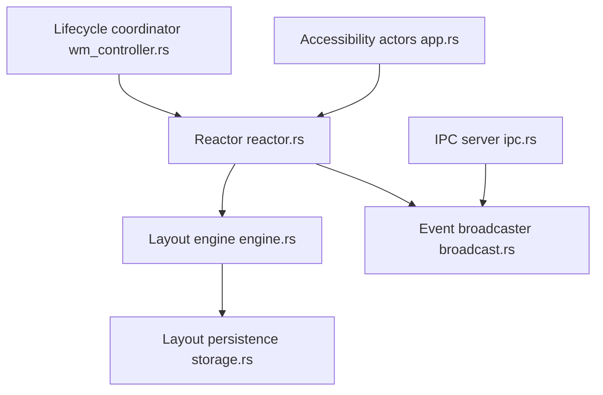

# acsandmann/rift

> Gestionnaire de fenêtres en mosaïque pour macOS, sans désactiver SIP, pour utilisateurs de i3 ou bspwm.

## Le problème
Les gestionnaires de fenêtres macOS existants demandent de désactiver SIP, n'animent pas ou gèrent mal plusieurs écrans avec Spaces séparés.

## Ce que ça fait vraiment
Plusieurs dispositions (mosaïque, BSP, maître-pile, colonnes défilantes, pile), icône de barre de menus, enregistrement et restauration de dispositions, configuration rechargée à chaud, IPC par ports Mach pour des programmes tiers. Écrit en Rust, utilise des API privées de macOS.

## Comment c'est branché

## Essayer
Aucune commande dans le README ; il renvoie à la documentation en ligne (quick start et configuration).

## Coût et pièges
Gratuit. Rust à compiler a priori (non documenté dans le README). Dépend d'API privées de macOS : risque de casse à chaque mise à jour du système.

## Ce que ce n'est pas
Pas un outil multiplateforme : macOS uniquement. Pas lié au travail data / IA. Dérivé de glide-wm, licence à vérifier.

## Alternatives
Aerospace (cité comme point de départ), yabai (source des API privées).

## Pour toi
Ignorer : un confort de poste de travail macOS, sans effet sur un travail data / IA / MLOps.

