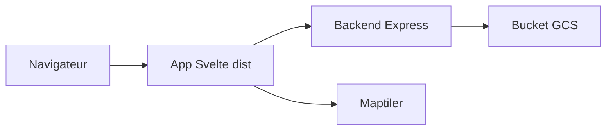

# acteng/atip

> Web tools to draw cycling and walking schemes and browse them with context layers.

## The problem
Local authorities struggle to map their active travel projects and compare them against contextual data.

## What it actually does
The repository contains the Scheme Sketcher and the Scheme Browser, two mapping tools, developed by the Alan Turing Institute with Active Travel England. A Svelte application is served by an Express backend, which reads files from a Google Cloud Storage bucket. The Scheme Sketcher can be adapted to another country through the shared library.

## How it is wired
Simplified diagram based on the fiche, no diagram provided.



## Trying it
```bash
npm install
npm run setup-govuk
npm run build
cd backend && cp -r ../dist . && npm install
gcloud auth application-default login
GCS_BUCKET=dft-rlg-atip-dev USE_IAP=false npm start
```

## Cost and gotchas
You need Node 22, an authenticated Google Cloud CLI and a Maptiler key (`VITE_MAPTILER_API_KEY`). The bucket cited is the team's own: you will have to provide yours. The development version offers no availability guarantee.

## What it is not
It is not a production service: the README states there is no guarantee on the compatibility of sketch files. It is not a general-purpose GIS tool.

## Alternatives
No alternative named in the README.

## For you
Watch: interesting if you map geographic data, but deployment depends on Google Cloud and a bucket you must recreate.
