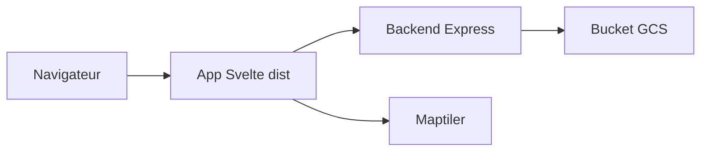

# acteng/atip

> Outils web pour dessiner des aménagements cyclables et piétons et les consulter avec des couches de contexte.

## Le problème
Les collectivités ont du mal à cartographier leurs projets de mobilité active et à les confronter à des données contextuelles.

## Ce que ça fait vraiment
Le dépôt contient le Scheme Sketcher et le Scheme Browser, deux outils de cartographie, développés par l'Alan Turing Institute avec Active Travel England. Une application Svelte est servie par un backend Express, qui lit des fichiers dans un bucket Google Cloud Storage. Le Scheme Sketcher peut être adapté à un autre pays via la bibliothèque commune.

## Comment c'est branché
Schéma simplifié d'après la fiche, sans diagramme fourni.



## Essayer
```bash
npm install
npm run setup-govuk
npm run build
cd backend && cp -r ../dist . && npm install
gcloud auth application-default login
GCS_BUCKET=dft-rlg-atip-dev USE_IAP=false npm start
```

## Coût et pièges
Il faut Node 22, la Google Cloud CLI authentifiée et une clé Maptiler (`VITE_MAPTILER_API_KEY`). Le bucket cité est celui de l'équipe : tu devras fournir le tien. La version de développement n'offre aucune garantie de disponibilité.

## Ce que ce n'est pas
Ce n'est pas un service de production : le README précise l'absence de garantie sur la compatibilité des fichiers de croquis. Ce n'est pas un outil généraliste de SIG.

## Alternatives
Aucune alternative nommée dans le README.

## Pour toi
À surveiller : intéressant si tu cartographies des données géographiques, mais le déploiement dépend de Google Cloud et d'un bucket que tu dois recréer.

