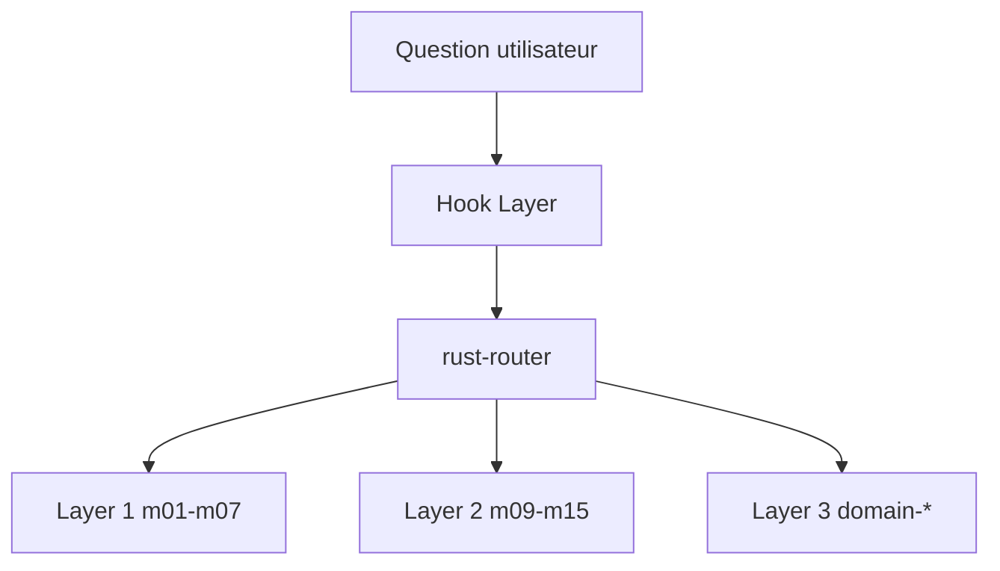

# actionbook/rust-skills

> Plugin and skills for Claude Code that steer the AI toward Rust solutions faithful to the business domain.

## The problem
Faced with an error like E0382, the AI suggests a quick `.clone()` without seeing the design constraint behind it.

## What it actually does
31 skills organized in three layers: language mechanics (m01 to m07), design choices (m09 to m15) and domain constraints (fintech, ML, cloud, IoT, web, CLI, embedded). A `rust-router` router picks skills according to the error or question. In plugin mode, hooks fire on more than 400 keywords. Commands fetch Rust versions and crate info, and generate skills from `Cargo.toml`.

## How it is wired


## Trying it
```bash
npx skills add actionbook/rust-skills
/plugin marketplace add actionbook/rust-skills
/plugin install rust-skills@rust-skills
```

## Cost and gotchas
Free. Background agents rely on `agent-browser` (permission to configure) and on the actionbook server. Without plugin mode, the hooks do not fire.

## What it is not
Not a Rust tool (no compiler or linter): these are instructions for the agent. No license is declared, which blocks reuse.

## Alternatives
No alternative named in the README.

## For you
Worth watching: interesting if you write Rust with Claude Code, but the absence of a license rules out relying on it for team use.
