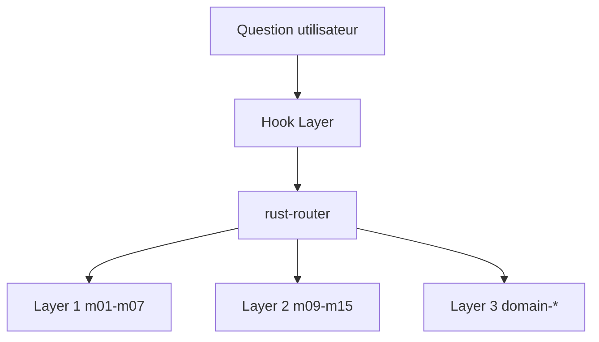

# actionbook/rust-skills

> Plugin et skills pour Claude Code qui guident l'IA vers des solutions Rust fidèles au domaine métier.

## Le problème
Face à une erreur comme E0382, l'IA propose un `.clone()` rapide sans voir la contrainte de conception en cause.

## Ce que ça fait vraiment
31 skills organisés en trois couches : mécanique du langage (m01 à m07), choix de conception (m09 à m15) et contraintes de domaine (fintech, ML, cloud, IoT, web, CLI, embarqué). Un routeur `rust-router` choisit les skills selon l'erreur ou la question. En mode plugin, des hooks se déclenchent sur plus de 400 mots-clés. Des commandes récupèrent les versions de Rust et les infos de crates, et génèrent des skills depuis `Cargo.toml`.

## Comment c'est branché


## Essayer
```bash
npx skills add actionbook/rust-skills
/plugin marketplace add actionbook/rust-skills
/plugin install rust-skills@rust-skills
```

## Coût et pièges
Gratuit. Les agents d'arrière-plan s'appuient sur `agent-browser` (permission à configurer) et sur le serveur actionbook. Sans le mode plugin, les hooks ne se déclenchent pas.

## Ce que ce n'est pas
Pas un outil Rust (pas de compilateur ni de linter) : ce sont des instructions pour l'agent. Aucune licence n'est déclarée, ce qui bloque la réutilisation.

## Alternatives
Aucune alternative nommée dans le README.

## Pour toi
À surveiller : intéressant si tu écris du Rust avec Claude Code, mais l'absence de licence interdit de t'y fier pour un usage d'équipe.

