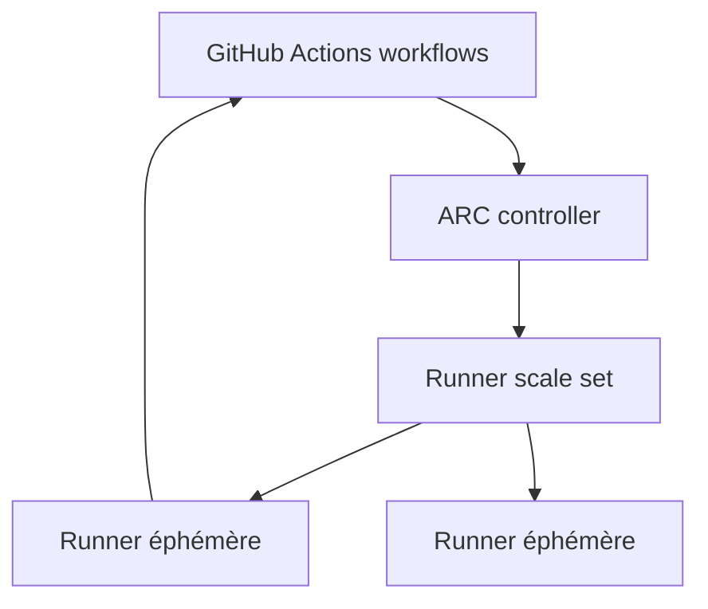

# actions/actions-runner-controller

> Kubernetes operator that orchestrates and scales self-hosted GitHub Actions runners.

## The problem
Running self-hosted GitHub Actions runners at scale requires creating, scaling and cleaning them up manually. Persistent runners are slow to recycle.

## What it actually does
Creates "runner scale sets" that scale automatically according to the number of running workflows (repo, org or enterprise). Ephemeral container-based runners: fast and clean scale up/down. Installation via Helm. Developed with the GitHub Actions team; the older autoscaling modes are legacy and community-maintained.

## How it is wired

## Trying it
No installation command in the README (it points to the Quickstart guide via Helm). Write it yourself: see the Quickstart on docs.github.com.

## Cost and gotchas
Free. Requires a Kubernetes cluster, Helm and a GitHub account with API authentication. Legacy autoscaling modes maintained by the community only.

## What it is not
Not a runner: it is the orchestrator that provisions them. Not for CI systems other than GitHub Actions.

## Alternatives
Not named in the README.

## For you
Useful if your GitHub CI/CD runs on Kubernetes and you want scalable runners; outside the direct data/AI scope.
